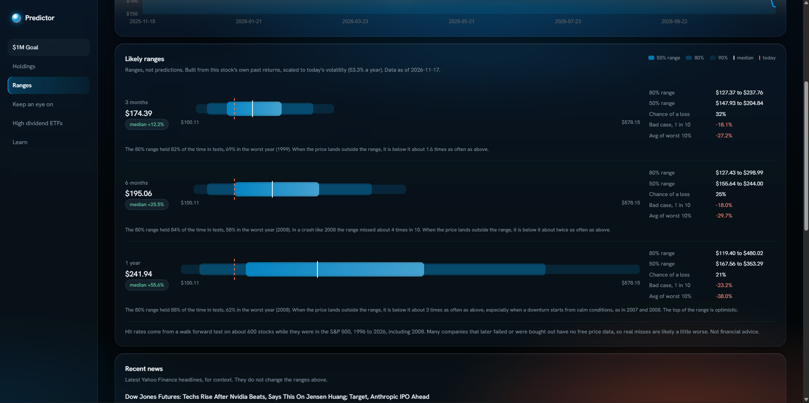

# Stock Predictor

[](https://github.com/jaysonnii/stock-predictor/actions/workflows/python-ci.yml)

**[Live demo](https://stockpredictor-nwgu.onrender.com)** · [API documentation](https://stockpredictor-nwgu.onrender.com/docs) · [Research notes](research/README.md)

[](https://stockpredictor-nwgu.onrender.com)

A stock and portfolio risk dashboard built with Python, FastAPI, NumPy, pandas, yfinance and a plain HTML/JavaScript frontend.

It shows **tested price ranges, not price targets**. For any ticker, and for a whole portfolio, it answers: where could this plausibly be in 3, 6 and 12 months, how likely is a loss, and how bad is a bad case? Every range is shown next to how often ranges like it actually held in walk-forward tests, including the worst year.

The demo runs on a free server that sleeps when idle, so the first load can take about a minute.

> Educational project. Nothing here is financial advice.

## What testing changed

The most useful part of this project is what the tests ruled out. Each idea below was tested walk forward: forecasts made only with data available at the time, then scored against what actually happened.

- **Price targets did not work.** The project started as a Random Forest model predicting future prices. It never beat simple baselines: on AMZN it lost to "the stock earns its average return" in every test period, and a model pooled across 93 stocks and ETFs lost to "same as SPY" in all four periods. It was removed from the app; the code stays in `research/`.
- **Ranges did work,** and can be checked honestly: if a range is labeled 80%, about 80% of real outcomes should land inside it. That is what the dashboard reports.
- **A momentum stock screen looked good, then didn't.** On 70 of today's large stocks, picking the top 20% by past-year return beat the average stock by +3.8 points a year, and random picks matched that only 2.4% of the time. Rerun on the stocks that were actually in the S&P 500 on each date since 1996, the edge fell to +0.03 points a year, and random picks did as well 46% of the time. The first result came from testing on companies already known to have won. The screen no longer picks stocks in the app.
- **Bad years were worse than the first test showed.** The original range test covered about 10 years and never saw 2008. On the point-in-time S&P 500 group, the 6-month 80% range held 84% of the time overall but only 58% in 2008, and misses land below the range 1.6 to 3 times as often as above. The app now shows those numbers.

Every experiment, its exact numbers and its decision are in [research/README.md](research/README.md). Rules for what counts as "working" were set before results were seen.

## Features

- **Ranges:** 50%, 80% and 90% price ranges for any ticker at 3, 6 and 12 months, chance of a loss, a 1 in 10 bad case, the average of the worst 10% of outcomes, and each range's tested hit rate and worst year
- **Holdings:** portfolio value, profit and loss, allocation, and joint value ranges for the whole portfolio, simulated so holdings fall together the way they do in real sell-offs
- **Keep an eye on:** a watchlist with price and daily move, a 1 month sparkline, where the price sits in its range, the latest headline and your own notes
- **Price alerts:** "tell me above / below" levels with a pop-up when a price crosses, optional desktop notifications, and automatic price checks every minute while the US market is open
- **Ideas worth a look:** a rule-based screen (analyst targets, value and growth) where each idea lists exactly why it was picked, and each rule shows its tested record, or says it can't be tested
- **News:** recent Yahoo Finance headlines for any ticker, shown as context only; they never change the ranges
- **High dividend ETFs:** a watchlist checked against live trailing yields
- **Learn:** short lessons on investing basics: index funds, risk, drawdowns, diversification, compounding, fees, account types and common mistakes
- **Goal tracker:** an opt-in savings goal with a daily check-in, progress, pace, streaks and a log of what you committed to each day
- Interactive API documentation, and tests on every push through GitHub Actions

## How the ranges work

1. Download about 10 years of daily prices through yfinance.
2. Divide each past daily return by the volatility at the time (EWMA, lambda 0.94), turning history into shock sizes with the market regime removed.
3. Resample those shocks in one-month blocks thousands of times, rescaled to today's volatility, which drifts back toward the stock's long-run level with a 63-day half-life.
4. Apply a small fixed shrink at 3 and 6 months, chosen in walk-forward tests, where the raw ranges ran slightly wide.
5. For a portfolio, every holding draws the **same** historical blocks, so stocks fall together in the simulation. Treating holdings as independent made portfolio ranges about 30% too narrow in testing.

### Walk-forward results

Share of real outcomes inside the 80% range (target 80):

| Horizon | Single stocks | Worst year | Portfolios | Worst year |
|---|---:|---:|---:|---:|
| 3 months | 82.1 | 68.5 (1999) | 82.3 | 68.3 (2018) |
| 6 months | 83.5 | 58.2 (2008) | 82.2 | 72.1 (2019) |
| 1 year | 87.7 | 62.3 (2008) | 85.8 | 66.0 (2021) |

- **Single stocks:** about 600 stocks while they were in the S&P 500, 1996 to 2026, about 116,000 to 120,000 forecasts per horizon. Membership comes from the free daily list at [fja05680/sp500](https://github.com/fja05680/sp500).
- **Portfolios:** 40 random equal-weight portfolios of 6 large stocks and ETFs, about 10 years. This test has not been rerun on the point-in-time group yet.
- When a single-stock range misses, the price lands below it 1.6 times (3 months) to 3 times (1 year) as often as above, and the top of the 1 year range is optimistic.

## Limitations

- **Survivorship bias, partly fixed.** The point-in-time test uses the companies that were in the S&P 500 at the time, not today's winners. But free price data is missing most members that later failed or were bought out (coverage is under 60% before 2008), so real misses are likely a little worse than measured.
- **Past prices only.** The ranges use no news, earnings or economic data.
- **Small effective sample.** Overlapping forecast windows across correlated stocks carry less independent information than the forecast counts suggest.
- **Not tested on everything.** Small caps and concentrated portfolios were not part of the tests.
- **Untested ideas.** Analyst targets and value/growth can't be tested with free data: yfinance has only today's analyst numbers and doesn't record fundamentals as they were known on past dates. The app labels them untested.
- **No accounts yet.** Holdings, watchlist, alerts and goal check-ins are saved in your browser. Alerts only fire while the site is open.

## Your own data

The public code starts blank. To start the app with your own holdings, goal and core beliefs, copy `personal.example.json` to `personal.json` and fill it in. `personal.json` is in `.gitignore`, so it stays on your computer. With it in place, goal check-ins are also saved to `goal_data/checkins.jsonl` on your computer. Without it, as on the hosted demo, the server stores nobody's check-ins.

## Project structure

```text
stock-predictor/
├── .github/workflows/python-ci.yml
├── static/index.html         # the dashboard
├── main.py                   # FastAPI app and routes
├── data.py                   # price download helpers
├── calibration.py            # bootstrap methods and calibration scoring
├── ranges.py                 # single-ticker ranges (/ranges)
├── portfolio.py              # joint portfolio ranges (/portfolio/ranges)
├── news.py                   # Yahoo headlines with fallbacks (/news)
├── signals.py                # price rules shared by the screen and its backtest
├── ideas.py                  # "Ideas worth a look" screen (/ideas)
├── goal_log.py               # local goal check-in log (/goal/checkins)
├── personal.example.json     # format for your own personal.json
├── start-predictor.ps1       # Windows: start the server and open the app
├── research/                 # experiments and findings, see research/README.md
├── tests/
├── requirements.txt
└── requirements-dev.txt
```

## Installation

Requires Python 3.11 or 3.12. Newer versions may not have wheels for the pinned packages.

```bash
git clone https://github.com/jaysonnii/stock-predictor.git
cd stock-predictor
```

Windows PowerShell:

```powershell
py -3.11 -m venv .venv
.\.venv\Scripts\Activate.ps1
python -m pip install --upgrade pip
pip install -r requirements-dev.txt
```

macOS or Linux:

```bash
python3.12 -m venv .venv
source .venv/bin/activate
python -m pip install --upgrade pip
pip install -r requirements-dev.txt
```

## Run the application

```bash
python -m uvicorn main:app --reload
```

Open `http://127.0.0.1:8000` for the app and `http://127.0.0.1:8000/docs` for the API documentation. On Windows, `start-predictor.ps1` starts the server if needed and opens the app; it can be scheduled to run at login or every morning.

## Testing

```bash
python -m pytest -q
```

Tests use synthetic or mocked data and make no live Yahoo Finance requests. They cover the bootstrap methods and their freedom from lookahead, range ordering and nesting, the joint portfolio simulation, the stock screen and its backtest rules, the point-in-time universe, news parsing, the goal log, the API endpoints, and a check that no personal data is written into the public page.

## Research

The experiments behind every number above, and how to rerun them, are in [research/README.md](research/README.md). Run them from the project folder as modules, for example:

```bash
python -m research.signal_backtest --pit
python -m research.evaluate_calibration_pit
```

The point-in-time scripts download history for about 1,200 companies the first time, which takes 10 to 20 minutes.

## API endpoints

| Method | Endpoint | Description |
|---|---|---|
| GET | `/` | The web application |
| GET | `/health` | API health status |
| GET | `/ranges?ticker=AAPL` | Price ranges and risk figures at 3, 6 and 12 months |
| POST | `/portfolio/ranges` | Joint value ranges for a list of holdings |
| GET | `/news?ticker=AAPL` | Recent Yahoo Finance headlines, newest first |
| GET | `/ideas` | Rule-based ideas with reasons and each rule's tested record |
| GET | `/history?ticker=AAPL&period=1y` | Historical closing prices |
| GET | `/info?ticker=AAPL` | Company and stock information |
| GET | `/dividend-etfs?tickers=QQQI,SCHD` | Live trailing dividend yields |
| GET, POST | `/goal/checkins` | Goal check-in log, only where `personal.json` exists |
| GET | `/goal/checkins.csv` | The check-in log as a spreadsheet file |
| GET | `/docs` | Interactive API documentation |

## Disclaimer

This application was created for educational and portfolio purposes. Its ranges describe historical behavior, are not predictions, and should not be treated as financial advice or used as the sole basis for investment decisions.

## Author

**Jay Soni**

- GitHub: [jaysonnii](https://github.com/jaysonnii)
- LinkedIn: [Jay Soni](https://www.linkedin.com/in/jayy-soni/)
