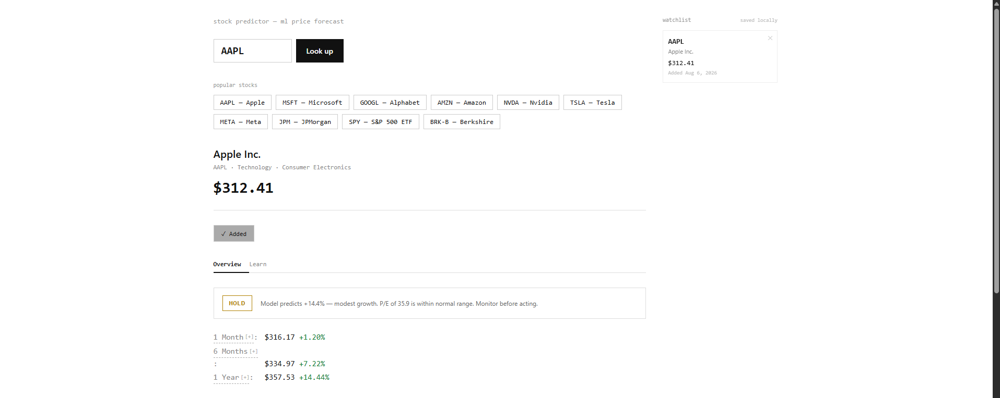

# Stock Predictor

[](https://github.com/jaysonnii/stock-predictor/actions/workflows/python-ci.yml)

[Live Demo](https://stockpredictor-nwgu.onrender.com) · [API Documentation](https://stockpredictor-nwgu.onrender.com/docs)

## Live Preview

[](https://stockpredictor-nwgu.onrender.com)

Click the preview to open the live application.

A stock and portfolio risk dashboard built with Python, FastAPI, NumPy, pandas, yfinance, and a browser frontend.

It shows **calibrated price ranges, not price targets**. For any ticker, and for a whole portfolio, it answers: where could this plausibly be in 3, 6 and 12 months, how likely is a loss, and how bad is a bad case? Every range is shown next to how often ranges like it actually held in walk-forward tests, including the worst year.

> This project is educational and should not be considered financial advice.

## Why ranges instead of price targets

The project started as a Random Forest price-target model. Tested walk forward, it never beat simple baselines: the single-stock model lost to the average return in every test period on AMZN, and a model pooled across 93 stocks and ETFs lost to "same as SPY" in all four periods. The full record is in [research/README.md](research/README.md).

Ranges can be checked honestly: if a range is labeled 80%, about 80% of real outcomes should land inside it. Those checks are what the dashboard reports.

## Features

- **Holdings:** portfolio value, profit and loss, allocation, and joint value ranges for the whole portfolio at 3, 6 and 12 months
- **Ranges:** 50%, 80% and 90% price ranges for any ticker, chance of a loss, a 1 in 10 bad case, and the average of the worst 10% of outcomes
- **Tested labels:** each range shows its walk-forward hit rate and its worst year
- **High dividend ETFs:** a watchlist checked against live trailing yields
- Interactive FastAPI documentation
- Automated tests through GitHub Actions

## How the ranges work

1. Download about 10 years of daily prices through yfinance.
2. Divide each past daily return by the volatility at the time (EWMA, lambda 0.94), turning history into shock sizes with the market regime removed.
3. Resample those shocks in one-month blocks thousands of times, rescaled to today's volatility, which drifts back toward the stock's long-run level with a 63-day half-life.
4. Apply a small walk-forward-fitted shrink at 3 and 6 months, where the raw ranges ran slightly wide.
5. For a portfolio, every holding draws the **same** historical blocks, so stocks fall together in the simulation the way they do in real sell-offs. Treating holdings as independent made portfolio ranges about 30% too narrow in testing.

### Walk-forward results

Share of real outcomes inside the 80% range (target 80):

| Horizon | Single stocks (93 tickers) | Worst year | Portfolios (40 random, 6 holdings) | Worst year |
|---|---:|---:|---:|---:|
| 3 months | 80.0 | 76 | 82.3 | 68 |
| 6 months | 83.3 | 77 | 82.2 | 72 |
| 1 year | 84.6 | 70 | 85.8 | 66 |

At 1 year, misses fall mostly below the range when a downturn starts from calm conditions.

## Limitations

- **Survivorship bias.** The test universe contains only companies that still trade today, so real downside misses are likely somewhat worse than measured.
- **Past prices only.** No news, earnings, dividends, or economic data.
- **Small effective sample.** Overlapping forecast windows across correlated stocks carry less independent information than the forecast counts suggest.
- **Not tested on everything.** Portfolio tests used equal-weight portfolios of large US stocks and ETFs; small caps and concentrated weights were not part of that test.
- Holdings and the ETF watchlist are saved in the browser's local storage.

## Project Structure

```text
stock-predictor/
├── .github/workflows/python-ci.yml
├── static/index.html      # the dashboard
├── main.py                # FastAPI app
├── data.py                # price download and feature helpers
├── calibration.py         # bootstrap methods and calibration scoring
├── ranges.py              # single-ticker ranges (/ranges)
├── portfolio.py           # joint portfolio ranges (/portfolio/ranges)
├── research/              # experiments and their findings, see research/README.md
├── tests/
├── pytest.ini
├── requirements.txt
└── requirements-dev.txt
```

## Installation

### 1. Clone the repository

```bash
git clone https://github.com/jaysonnii/stock-predictor.git
cd stock-predictor
```

### 2. Create a virtual environment (Python 3.11)

Windows PowerShell:

```powershell
py -3.11 -m venv .venv
.\.venv\Scripts\Activate.ps1
```

### 3. Install dependencies

```powershell
python -m pip install --upgrade pip
pip install -r requirements-dev.txt
```

## Run the Application

```powershell
python -m uvicorn main:app --reload
```

Open `http://127.0.0.1:8000` for the app and `http://127.0.0.1:8000/docs` for the API documentation.

## Testing

```powershell
python -m pytest -q
```

Tests use synthetic or mocked data and make no live Yahoo Finance requests. They cover the bootstrap methods and their freedom from lookahead, range ordering and nesting, the joint portfolio simulation, the API endpoints, and the research code. They run on every push and pull request to `main`.

## Research

The experiments that led here, and how to rerun them, are in [research/README.md](research/README.md). Run them from the project folder as modules, for example `python -m research.evaluate_portfolio`.

## API Endpoints

| Method | Endpoint | Description |
|---|---|---|
| GET | `/` | Opens the web application |
| GET | `/health` | Returns the API health status |
| GET | `/ranges?ticker=AAPL` | Price ranges and risk figures at 3, 6 and 12 months |
| POST | `/portfolio/ranges` | Joint value ranges for a list of holdings |
| GET | `/history?ticker=AAPL&period=1y` | Historical closing prices |
| GET | `/info?ticker=AAPL` | General company and stock information |
| GET | `/dividend-etfs?tickers=QQQI,SCHD` | Live trailing dividend yields |
| GET | `/docs` | FastAPI documentation |

## Disclaimer

This application was created for educational and portfolio purposes. Its ranges describe historical behavior, are not predictions, and should not be treated as financial advice or used as the sole basis for investment decisions.

## Author

**Jay Soni**

- GitHub: [jaysonnii](https://github.com/jaysonnii)
- LinkedIn: [Jay Soni](https://www.linkedin.com/in/jayy-soni/)
